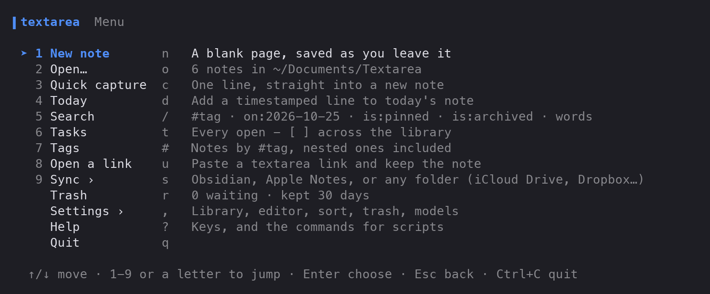
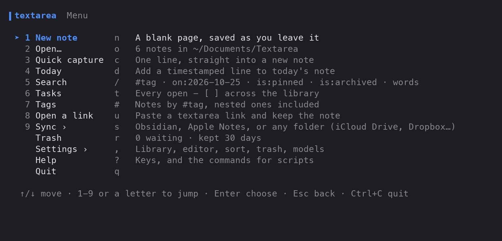
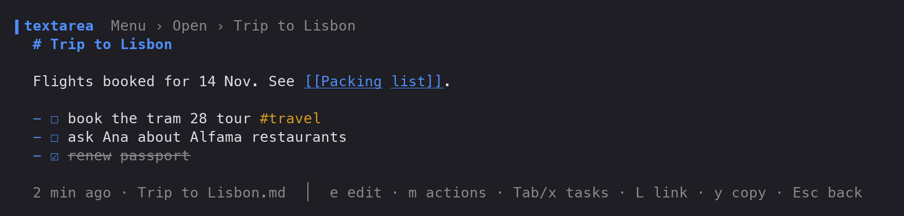

<div align="center">

# textarea-cli

[textarea](https://gitguy268.github.io/textarea-cli/) in the terminal. Type `text` for a menu, or `text buy milk` to jot something down without opening anything. The notes are the same Markdown files the web app's Folder sync writes, and they sync with Obsidian, Apple Notes and any folder.

[Features](#features) · [Install](#install) · [Use it](#use-it) · [Sync](#sync) · [Settings](#settings) · [Limits](#limits) · [Contributing](#contributing)




</div>

<!-- live-links -->
**Project page:** [gitguy268.github.io/textarea-cli](https://gitguy268.github.io/textarea-cli/) · [textarea-cli.vercel.app](https://textarea-cli.vercel.app)
<!-- /live-links -->

## Install with Homebrew

```sh
brew trust gitguy268/tap
brew install gitguy268/tap/textarea-cli
```

Installs the `text` command.

<!-- run-steps:start -->
## Run it locally, step by step

1. **Install [Go](https://go.dev/dl/) 1.27** or newer.

2. **Get the code:**

   ```sh
   git clone https://github.com/Gitguy268/textarea-cli.git
   cd textarea-cli
   ```

3. **Build it:**

   ```sh
   go build -o text ./cmd/text
   ```

4. **Run it:**

   ```sh
   ./text
   ./text buy milk
   ```
<!-- run-steps:end -->

## Features

| | What you get |
|---|---|
| Menu | `text` opens a numbered menu. Pick a row with ↑/↓, its number or its letter. Esc goes back. |
| Quick capture | `text call the plumber #home` saves a note and returns to the prompt. `echo … \| text -` reads stdin. |
| Today | `text today walked the dog` adds a timestamped line to the day's note. |
| Notes | Open with a fuzzy filter, read with Markdown highlighting, and edit in the built-in editor or `$EDITOR`. Pin, archive, backlinks, `[[wikilinks]]` and word counts. |
| Search | The web app's grammar: words, `#tag`, `on:2026-10-25`, `is:pinned`, `is:archived`. |
| Tasks | Every open `- [ ]` across your notes in one list. `x` ticks a task in its note. |
| Share | A link that opens the note in the web app, optionally with a password (AES-256-GCM), plus a QR code in the terminal. `text open-link` keeps a note from such a link. |
| Export | Plain text, Markdown, HTML, JSON, CSV, XML, RTF, LaTeX and YAML, to a file or the clipboard. |
| Sync | Two-way with any folder (iCloud Drive, Dropbox, Google Drive, OneDrive, a USB stick), an Obsidian vault, or Apple Notes on a Mac. |
| Trash | Deleted notes wait 30 days and can be restored. |
| Optional AI | Speech to text with whisper.cpp, and the web app's five writing tools with llama.cpp, a llamafile or Ollama. Both run on your machine, and their menu rows appear only when the tools are installed. |



## Install

With Go 1.27 or newer:

```sh
go install github.com/Gitguy268/textarea-cli/cmd/text@latest
```

Or build from a clone:

```sh
git clone https://github.com/Gitguy268/textarea-cli.git
cd textarea-cli
go build -o text ./cmd/text
```

It is pure Go (no CGO), so `GOOS=linux`, `darwin` or `windows` cross-compiles.

## Use it

```sh
text                          # the menu
text buy milk #home           # capture a note
text -- rm the old boxes      # capture words that start like a command
echo "from a script" | text - # capture from stdin
text today called the bank    # add a timestamped line to today's note
```



While reading a note: <kbd>e</kbd> edit, <kbd>m</kbd> all actions, <kbd>Tab</kbd> next task and <kbd>x</kbd> ticks it, <kbd>L</kbd> share link, <kbd>y</kbd> copy as, <kbd>Esc</kbd> back. <kbd>?</kbd> in the menu lists every key.

<details>
<summary><b>Commands for scripts</b></summary>

Every command that lists notes takes `--json`. A note can be named by its file name, its id or the start of it, or any piece of its title (its first line when it has no heading) that only one note matches.

| Command | What it does |
|---|---|
| `text ls [query]` | List notes, filtered by the search grammar |
| `text show <note>` | Print a note |
| `text edit <note>` | Edit in the built-in editor or `$EDITOR` |
| `text new [text]` | Make a note and open it in the editor |
| `text tasks [--all]` | Open tasks across the library (`--all` adds done ones) |
| `text link <note> [-p password]` | Print a share link |
| `text open-link <url>` | Keep a note from a share link |
| `text export <note> -f md` | Export as `txt`, `md`, `html`, `json`, `csv`, `xml`, `rtf`, `tex` or `yml` |
| `text sync [name] [--dry-run] [--watch 30s]` | Sync every target, or one |
| `text rm <note>` | Move a note to the trash |
| `text trash [restore\|empty]` | The trash |
| `text config [path]` | Print the settings, or where they live |

</details>

## Sync

The library is a folder, `~/Documents/Textarea` by default. Each note is `Title.md` with a short front matter block (`id`, `created`, `updated`, `words`, `style`) and then the text, exactly as the web app's Folder sync writes it. To share notes with the web app, point its Folder sync at the same folder; nothing needs converting.

```sh
text sync --add folder --path ~/Dropbox/Notes
text sync --add obsidian                # finds your vault; --path picks one
text sync --add applenotes              # macOS: a "Textarea" folder in Notes
text sync --dry-run                     # what the next sync would do
text sync                               # do it
```

Or use **Sync ›** in the menu.

<details>
<summary><b>How sync decides</b></summary>

Sync is the same decision table as the web app's Folder sync, translated to Go and tested against it:

- **The newest edit wins.** Each target keeps a manifest of what it last saw, by note id.
- **Deleting a note** in the library moves its copy out of the target, and deleting it in the target moves it to the library's trash.
- **Files sync never created** are only imported, never removed. The first sync deletes nothing.
- **Pinned, archived and trashed** state lives in `.textarea/` next to the notes, never in the front matter, so the web app doesn't drop it when it rewrites a file.

**Obsidian:** notes go into a `Textarea` folder in the vault, where the front matter shows as properties. Vaults are found from Obsidian's own `obsidian.json`.

**Apple Notes:** notes go into a Notes folder of their own, through JavaScript for Automation. `#`, `##` and `###` headings become Notes' title, heading and subheading styles. Everything else goes over as written, Markdown marks included, so it comes back exactly. Formatting you add inside Notes (bold, italic, strikethrough, links, bulleted, numbered and check lists) comes back as Markdown. A Notes note only counts as changed when its modification date moves, so a lossy round trip never looks like an edit. Sync never deletes a note it didn't create, and it skips locked notes. The first sync makes macOS ask whether your terminal may control Notes; a dry run reads Notes but creates nothing.

</details>

## Settings

**Settings ›** in the menu covers the library folder, editor, sort order, how long the trash keeps notes, a word goal and the AI models. They're stored in `config.json` (`text config path` shows where).

| Variable | Effect |
|---|---|
| `TEXT_LIBRARY` | Use this library folder instead of the configured one |
| `XDG_CONFIG_HOME` | Where `textarea-cli/config.json` lives, on every system |
| `VISUAL`, `EDITOR` | The external editor, when Settings chooses it |
| `WHISPER_MODELS` | A folder to look for whisper.cpp `ggml-*.bin` models in |
| `TEXT_LLM_URL` | A llama-server or llamafile that's already running |

<details>
<summary><b>Optional speech and writing tools</b></summary>

Nothing is downloaded for you. Install what you want and give the model path in Settings:

- **Speech to text:** [whisper.cpp](https://github.com/ggml-org/whisper.cpp) (`whisper-cli`) with a `ggml-*.bin` model. Recording uses ffmpeg or sox's `rec`; transcribing a file other than `.wav` needs ffmpeg. The web app's in-browser models can't be reused here.
- **Writing tools** (improve, shorten, summarise, fix, casual): [llama.cpp](https://github.com/ggml-org/llama.cpp)'s `llama-server` with a GGUF model, a `.llamafile`, or [Ollama](https://ollama.com) with a model pulled. The prompts are the web app's.

</details>

## Limits

- **Apple Notes** sync has been run against Notes.app on macOS with an iCloud account: both-way edits, notes made in Notes, and deletes on each side. It is macOS only.
- Notes formatting that Markdown can't express (fonts, colours, tables, drawings, attachments) doesn't survive a round trip through Apple Notes.
- Sync runs when you ask, or while `text sync --watch` is running. There's no background service.
- Speech and writing tools need the separate programs above. They're optional, and untested in CI.

## Contributing

See [CONTRIBUTING.md](CONTRIBUTING.md) for building, the checks, and the tests that compare the Go code with the web app's JavaScript. Please report security problems privately: see [SECURITY.md](SECURITY.md).

## Licence

MIT, see [LICENSE](LICENSE). Parts are Go translations of textarea's code, and textarea's copyright lines are kept. [NOTICE](NOTICE) lists the libraries it's built with and the projects that inspired parts of the design.
